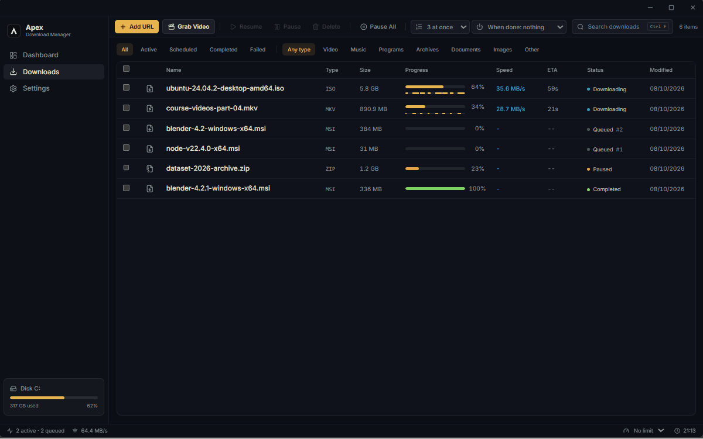
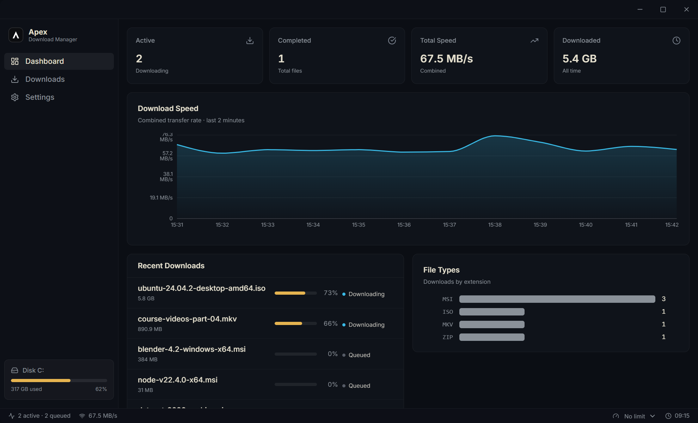
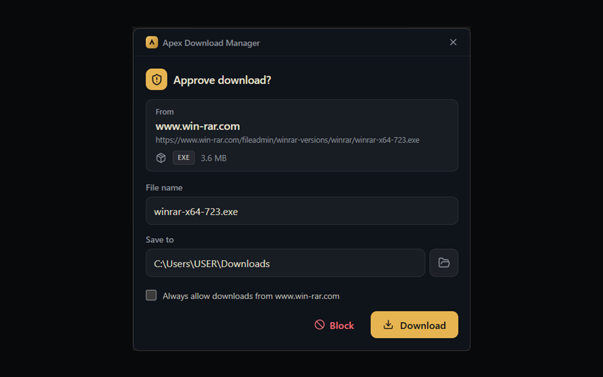

# Apex Download Manager

<h3 align="center">A free, open source alternative to IDM. No trial, no ads, no account.</h3>

<p align="center">
  <a href="https://apexdownloadmanager.com/dl"></a>
  <a href="https://apexdownloadmanager.com/dl?os=linux"></a>
  <a href="https://apexdownloadmanager.com/dl?os=deb"></a>
</p>

<p align="center">
  <b>Browser extension:</b>
  <a href="https://chromewebstore.google.com/detail/apex-download-manager/gopdilekdjnfekbmhedjidlmaahnnhco">Chrome</a> ·
  <a href="https://microsoftedge.microsoft.com/addons/detail/apex-download-manager/bjpggfmgbhafacbcmhpncjaapdknohjg">Edge</a> ·
  <a href="https://addons.mozilla.org/en-US/firefox/addon/apex-download-manager/">Firefox</a> ·
  <a href="https://apexdownloadmanager.com/">Website</a>
</p>

<p align="center">
  <a href="https://github.com/ThembaTman0/apex-download-manager/stargazers"></a><br>
  <sub>⭐ Find Apex useful? A star helps other people find it. Apex has no ads and no marketing budget.</sub>
</p>

Apex splits every download across up to 32 connections, resumes from the exact
byte after a pause, a reboot or a dropped connection, and takes over downloads
from your browser. A native Rust engine in a small Tauri app: no Electron, no
Java. The Windows installer is about 4 MB. GPL v3.

| | Apex | IDM |
| --- | --- | --- |
| Price | **Free** | Paid, after a 30-day trial |
| Open source | **Yes** (GPL v3) | No |
| Runs on | **Windows and Linux** | Windows |
| Browser extension reading your pages | **Can't**: it has no content scripts | Reads every page to add its buttons |
| Ads, sign-up, telemetry | **None** | Registration reminders |
| Resume after a reboot | Yes, checked against the server's ETag | Yes |
| Video grabbing | yt-dlp, with the full YouTube quality list | Built in |



<table>
  <tr>
    <td width="50%"></td>
    <td width="50%"></td>
  </tr>
  <tr>
    <td align="center">Live speed and totals</td>
    <td align="center">Downloads from your browser, approved in one click</td>
  </tr>
</table>

---

## Install

**Windows 10/11 (x64)**

- **Installer:** [download](https://apexdownloadmanager.com/dl) (about 4 MB).
  Apex updates itself from then on.
- **Scoop:**
  ```powershell
  scoop bucket add apex https://github.com/ThembaTman0/apex-download-manager
  scoop install apex/apex-download-manager
  ```
- **winget:** `winget install ThembaTman0.ApexDownloadManager`
- **Chocolatey:** `choco install apex-download-manager`
- **Portable** (from 1.2): unzip `Apex.Download.Manager_<version>_x64_portable.zip`
  from the [releases page](https://github.com/ThembaTman0/apex-download-manager/releases)
  anywhere, USB drives included. Your downloads list and settings stay in a
  `data` folder beside the exe. Updates are manual.

**Linux (x64)**

- **AppImage:** [download](https://apexdownloadmanager.com/dl?os=linux), make it
  executable (`chmod +x`) and run it. It updates itself like the Windows app.
- **.deb** (Debian, Ubuntu, Mint): [download](https://apexdownloadmanager.com/dl?os=deb)
  and install with `sudo apt install ./Apex*.deb`. Updates come from new .deb
  releases, not from inside the app.

Video grabbing uses the `yt-dlp` (and optionally `ffmpeg`) from your system:
install them with your package manager. Windows-only for now: Mark-of-the-Web
tagging, taskbar progress and the one-click yt-dlp/FFmpeg install.

**Verify a download** (from 1.2). Every installer is built by this repo's
[release workflow](.github/workflows/release.yml) and carries a signed
build-provenance attestation, so you can check that the file came from that
workflow and this source, unmodified:

```
gh attestation verify <downloaded file> --repo ThembaTman0/apex-download-manager
```

Each release also lists `SHA256SUMS-windows.txt` and `SHA256SUMS-linux.txt`.

**Command line:** `--minimized` starts Apex in the tray, `--help` lists the options.

## Features

**Engine**
- Multi-connection segmented downloads (up to 32 parallel streams per file)
- Pause / resume that survives app restarts - per-segment progress is persisted.
  After a restart, unfinished downloads wait paused until you resume them;
  scheduled downloads keep their time and start on their own
- Resume integrity: `ETag`/`If-Range` validation prevents silently corrupted files
- Automatic retry with backoff on stalls and dropped connections
- Refresh an expired link: paste a fresh address (right-click → Refresh
  Address…) and the download carries on from the bytes already on disk
- Download queue with a concurrency limit and global speed limiting
- Per-download speed caps, adjustable live while the download runs
- Proxy support (HTTP / HTTPS / SOCKS5, with authentication)
- Scheduling: start any download at a chosen time, sleep/shut down when the queue finishes
- Video grabber: yt-dlp integration with quality picker, playlists, and
  one-click tool install (ffmpeg merging for highest resolutions)
- Auto-organize: sorts downloads into category folders (Video, Music,
  Programs, Archives, Documents…). Each category can have its own folder,
  even on another drive, and you can send extra file types to it
  (Settings → Auto-organize → "Sort downloads into category folders")
- Stream grab: on Firefox and Edge the extension sniffs the `.m3u8`/`.mpd`
  manifest and passes the player's referer through, so players that build the
  stream in script work even though there is no address to copy. The Chrome
  Web Store build ships without the grab feature, by their policy
- Download progress on the Windows taskbar

**Capture**
- Browser extension (Chrome / Edge / Brave / Firefox) that hands downloads to
  Apex - and safely falls back to the browser when Apex isn't running
- Cookie/referer handoff so downloads behind logins just work
- Clipboard watcher: copy a download link anywhere, get a one-click toast
- Drag & drop URLs onto the window, batch-add multiple URLs at once

**Safety**
- Carries its own up-to-date list of trusted certificate authorities alongside
  the Windows one, so sites with newer certificates work on the first try
- Every completed file is tagged with Mark-of-the-Web so Windows SmartScreen
  and Defender scan it like a browser download
- Built-in SHA-256 checksum verification against publisher-provided hashes
- The extension has **no content scripts**: it cannot read or change your pages.
  It asks for site access only to pass a download's cookies to Apex and, on
  Firefox and Edge, to spot video stream addresses. It talks only to Apex on
  your own machine
- Local-only: no accounts, no telemetry, nothing leaves your machine

**Interface**
- Minimal dark UI: dashboard with live speed chart, filterable download list,
  per-download properties panel with live segment view
- Keyboard-first: `Ctrl+N` new download, `Ctrl+F` search, `Space` pause/resume,
  `Del` delete, `Enter` open
- Global shortcuts that work from any app (off by default): `Ctrl+Shift+Alt+P`
  pauses everything and resumes it again, `Ctrl+Shift+Alt+A` opens Add URL
  with the copied link filled in. On Linux these need X11
- Optional sound when a download finishes
- System tray: close the window, keep downloading

## Project layout

```
apex-download-manager/
├── desktop-ui/            # Tauri v2 app
│   ├── src/               # React 19 + TypeScript + Tailwind v4 frontend
│   └── src-tauri/         # Rust: download engine, SQLite, capture server
├── browser-extension/     # Chrome/Edge/Firefox extension (capture + context menu)
├── website/               # Landing page (Vite + React) and /dl download links
├── bucket/                # Scoop manifest
├── packaging/             # Chocolatey package
└── winget/                # First winget manifest (later ones are generated)
```

## Building from source

**Windows:** [Rust](https://rustup.rs) (stable, MSVC toolchain),
[Node.js](https://nodejs.org) ≥ 20, and the Visual Studio Build Tools
(C++ workload + Windows SDK).

```powershell
cd desktop-ui
npm install
npm run tauri dev      # development
npm run tauri build    # produces MSI / NSIS installers
```

**Linux** (Debian/Ubuntu package names): Rust (stable), Node.js ≥ 20, and the
system libraries Tauri needs.

```bash
sudo apt install libwebkit2gtk-4.1-dev libgtk-3-dev libayatana-appindicator3-dev librsvg2-dev patchelf
cd desktop-ui
npm install
npm run tauri dev
npm run tauri build -- --bundles appimage,deb
```

### Browser extension

1. Open `chrome://extensions`, enable **Developer mode**, click **Load unpacked**,
   select the `browser-extension/` folder.
2. In Apex: **Settings → Browser Integration**, copy the pairing token.
3. Click the extension icon, paste the token, **Save** - the status dot turns green.

## Architecture notes

[DESIGN.md](DESIGN.md) explains how the engine works, why, and which
alternatives were turned down. The short version:

- The engine probes each URL with a ranged request, plans segments, and writes
  all connections into one preallocated temp file (`.adm`), renamed on completion.
- State lives in SQLite (WAL) under `%APPDATA%/com.apex.download-manager/`
  (on Linux, `~/.local/share/com.apex.download-manager/`).
- The extension talks to a token-gated HTTP endpoint bound to `127.0.0.1:43666`.
  Interception is cancel-then-hand-off: the browser download is cancelled
  immediately (before any Save As dialog), then handed to Apex - and restarted
  in the browser if Apex is unreachable or rejects it, so nothing is lost.

## Roadmap

- [x] Video grabber (yt-dlp integration)
- [x] Cookie handoff for authenticated downloads
- [x] Proxy support
- [x] Firefox extension
- [x] Auto-updates (GitHub Releases)
- [x] Dynamic segment re-splitting (a finished connection takes over half of the largest remaining piece)
- [ ] Code signing
- [x] Extension store publishing (Chrome Web Store / Edge Add-ons / AMO)
- [x] Bandwidth scheduler (off-peak speed profiles)
- [x] Package managers: Scoop (own bucket), winget, Chocolatey
- [x] Linux build: AppImage and .deb (thanks to [@YofaGh](https://github.com/YofaGh) for testing, [#1](https://github.com/ThembaTman0/apex-download-manager/issues/1))
- [x] Refresh Address for expired links, completion sound, global shortcuts
- [ ] Portable zip for Windows
- [ ] Settings grouped into categories
- [ ] Arch Linux package ([#55](https://github.com/ThembaTman0/apex-download-manager/pull/55))

## Contributing

Bug reports, ideas and pull requests are welcome. See
[CONTRIBUTING.md](CONTRIBUTING.md) for how to build, test and send a change,
and [SECURITY.md](SECURITY.md) for reporting a security problem.

## Support Apex

Apex is free and built by one person. If it saves you time:

- ⭐ **Star this repo** - it is the main way other people find Apex.
- ☕ **[Buy me a coffee on Ko-fi](https://ko-fi.com/thembatman0)** - support goes towards a code-signing certificate, so Windows stops warning on install.
- 🐛 **[Report a bug or request a feature](https://github.com/ThembaTman0/apex-download-manager/issues)**.

## License

Copyright © 2026 ThembaTman0.

Apex Download Manager is free software: you can redistribute it and/or modify
it under the terms of the GNU General Public License as published by the Free
Software Foundation, either version 3 of the License, or (at your option) any
later version. See [LICENSE](LICENSE) for the full text.

It is distributed in the hope that it will be useful, but WITHOUT ANY WARRANTY;
without even the implied warranty of MERCHANTABILITY or FITNESS FOR A
PARTICULAR PURPOSE.
